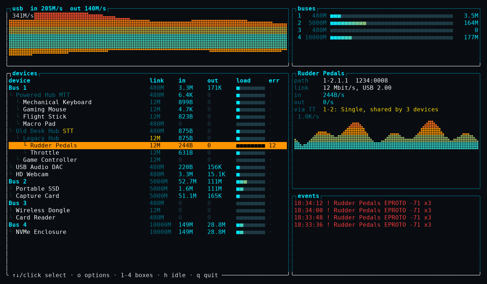
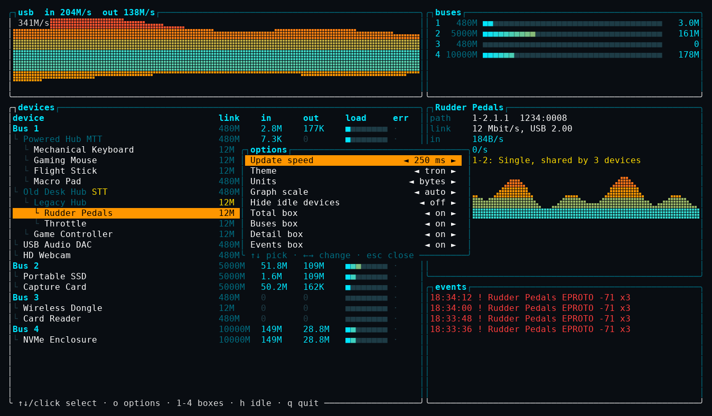

# usbtron

A btop-style USB monitor for Linux. It shows you what's moving over your USB
ports, how your hubs are really wired, and when something starts throwing
errors.



*That's `--demo` mode, so the hardware in the picture is made up.*

## Why I made this

I was chasing an odd input problem on a desktop with way too much plugged into
it, and I wanted to look at my USB setup the way I look at everything else in
btop. usbtop did the job, but it's a plain text list and I kept wishing it was
nicer to live with. So I started over with graphs, the hub tree, and the stuff
I actually wanted to know.

The biggest surprise was learning about transaction translators. Slow devices
like keyboards, mice and flight sticks run at 12 Mbit/s, and when they go
through a USB 2 hub, a little chip called a translator handles them. A Single
TT hub has one for the whole hub, so every slow device on it shares the same
12 Mbit/s, no matter what speed is printed on the box. A Multi TT hub gives each
port its own. Almost nobody puts this on the packaging, and I'd never thought
about it until I went looking.

## What it shows

- Live graphs for total traffic, and for whichever device you've selected
- A meter for each bus
- Your whole hub tree, with in, out, link speed, load and errors for every device
- Hub rows that add up everything below them, so you can spot a busy branch
- `STT` and `MTT` tags on hubs, plus which translator a slow device goes through
  and how many other devices are sharing it
- A warning when a USB 2 hub is stuck at 12 Mbit/s, which is often a bad cable
  or connection
- A running log of USB errors and things being plugged in or pulled out

It works with the keyboard or the mouse, and there's an options menu with themes
and the rest.

## Install

You'll need Linux, a recent stable Rust, and `usbmon` in your kernel
(`CONFIG_USB_MON`). Most distros already have it.

```sh
cargo install --git https://github.com/Tomcatt/usbtron
```

Or from a checkout:

```sh
git clone https://github.com/Tomcatt/usbtron
cd usbtron
cargo build --release
```

## Usage

```sh
usbtron              # live monitor
usbtron --demo       # invented hardware; no root needed
usbtron --dump 3     # print one table after 3 seconds and exit
```

Watching USB traffic takes root, so if usbtron can't open `/dev/usbmon0` it
restarts itself with `sudo` and loads `usbmon` for you. Want a look first? Run
`--demo`, which doesn't need root at all.

### Keys

| Key | Action |
|---|---|
| `↑` `↓`, `j` `k`, wheel, click | Select a device |
| `PgUp` `PgDn` | Move faster |
| `o` or `Esc` | Open or close options |
| `1` `2` `3` `4` | Toggle the Total, Buses, Detail and Events boxes |
| `h` | Hide or show idle devices |
| `q` | Quit |

### Options



Changes save right away to `~/.config/usbtron/usbtron.conf`, and the file stays
yours even though the app runs through `sudo`.

Two worth trying: log graphs, so one fast drive doesn't flatten everything else,
and hide idle devices. That one keeps anything that moved data in the last 30
seconds or has logged an error, so rows don't blink in and out.

## How it works

usbtron reads events from the kernel's `usbmon` interface, adds up the bytes per
device, and matches them against the tree in `/sys/bus/usb/devices`.

Running a USB tool as root is a fair thing to be nervous about, since USB is
also where your keystrokes travel. usbtron only asks the kernel for each event's
header: which device, which direction, how many bytes, and whether it worked. It
never fetches the data itself, so it can't see what you type.

## What it can't do

- It counts finished transfers and skips USB's own overhead, so a meter
  shows data against the link's raw speed. You'd run out of room before it
  fills up.
- It can't tell a stalled device from an idle one unless the kernel reports an
  error. I'd love to fix this, and I don't have a good answer yet.
- It only sees errors from while it's running. For older ones, try
  `journalctl -k`.
- It's Linux only, and so far I've only run it on my own Arch-based desktop. If
  it does something strange on yours, please open an issue.

## Development

```sh
cargo test
cargo clippy --all-targets -- -D warnings
cargo fmt --check
```

## Thanks

The idea comes from [usbtop](https://github.com/aguinet/usbtop) by Adrien Guinet,
and the look comes straight from [btop](https://github.com/aristocratos/btop).
usbtron is its own code, but it wouldn't exist without either of them.

## License

[BSD 3-Clause](LICENSE)
